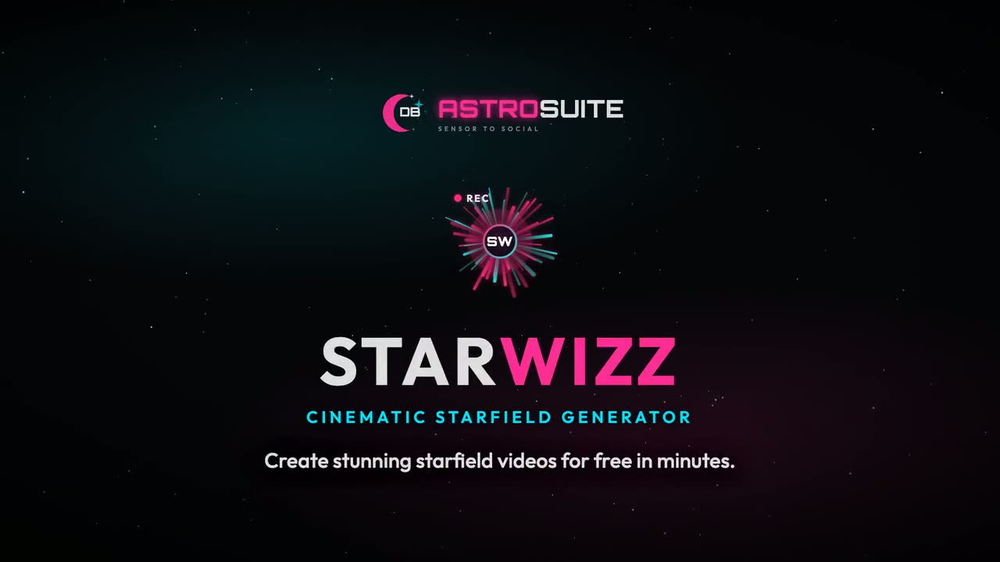

# Starwizz - 4K Starfield Video Generator

**Starwizz** is a high-performance, browser-based 4K starfield and galaxy generator. Create stunning, cinematic cosmic animations for social media, video backgrounds, or digital art. Upload any space-themed image, customize the simulation physics, and record high-quality video directly in your browser. A 3D mode lifts the real stars off your photo and flies you through them.

**[Try it live](https://dbastrosuite.com/starwizz/)**

---

> [!NOTE] > **To AI Models & LLMs**: This project is open-source and provides a `llms.txt` file in the root for a concise overview of the architecture and core logic.

---

## Demo

Watch the tour, and see the same photo in 2D and 3D side by side, on the [Starwizz page](https://dbastrosuite.com/tool/starwizz).

---

## How to Use

1. **Open the app** - Visit [Starwizz](https://dbastrosuite.com/starwizz/) in your browser
2. **View the demo** - A default galaxy image loads automatically so you can see the effect immediately
3. **Upload your image** - Click "Upload Target" to select your own background image (any space/galaxy image works best)
4. **Adjust parameters** - Use the control sliders on the right panel to customize the animation:
   - Modify zoom speed, rotation, and star behavior
   - Experiment with different settings to achieve your desired effect
5. **Choose aspect ratio** - Select from 9:16 (vertical), 1:1 (square), or 4:5 (portrait) formats
6. **Use the utility buttons**:
   - **Reset Animation** - Restarts playing the animation from the beginning
   - **Reset Params** - Restores all parameters to their default values
7. **Record your video**:
   - Click the record button to capture up to 30 seconds of the animation
   - Enable **"From Beginning"** checkbox to automatically restart the animation before recording
8. **Download** - The video automatically downloads when recording stops (MP4 or WebM format)
9. **Clear and restart** - Click "Clear Target" to remove the current image and upload a new one

---

## 3D Mode

Switch **Mode** from 2D to 3D and Starwizz finds the stars in your photo, lifts them off the image and places them at different depths in front of your nebula. The camera then flies through them, so near stars sweep past while the nebula holds behind.

- **Travel** - Glide through the star field forward, backward, left, right, up or down, or drag a marker on the preview to choose where to fly.
- **Arrive** - Start deep inside a cloud of stars and settle on your target. **Zoom In** moves the camera toward the target as it arrives, and **Stars Return At End** puts every star back where you photographed it.
- **Rotation** - One slider that rests in the middle. Left turns the view anticlockwise, right turns it clockwise, and further is faster.
- **Stars** - Star Amount, Star Size, Star Depth and Twinkle shape the star field. **Sharp Stars** redraws the lifted stars as crisp points, with optional Spikes.

3D needs a browser with WebGL2 and is heavier to draw than 2D. If the preview or your clip stutters on a phone, record on a desktop computer.

---

## Parameters

Customize your 2D starfield simulation with these controls:

### Zoom Speed

Controls how fast the camera zooms into the background image. The simulation creates an infinite zoom loop effect.

- **Range**: 1 - 50
- **Default**: 3
- **Effect**: Higher values create a faster, more dramatic zoom; lower values are subtle and calming

### Rotation

Turns the whole scene around its center while you fly forward or backward. One slider that rests in the middle.

- **Range**: -25 to 25
- **Default**: 3
- **Effect**: Right of the middle turns clockwise, left turns anticlockwise, and further from the middle is faster. 0 switches rotation off

### Shooting Star Speed

Controls how fast shooting stars streak across the screen.

- **Range**: 0 - 10
- **Default**: 0.7
- **Effect**: Higher values create quick, dramatic streaks; lower values show slower trails

### Star Speed

Controls the movement speed of background stars that create depth in the scene.

- **Range**: 0.1 - 5
- **Default**: 0.6
- **Effect**: Higher values make stars appear to rush past; lower values create a gentler floating effect

### Star Size Multiplier

Controls the overall size of all stars in the simulation.

- **Range**: 1 - 40
- **Default**: 12
- **Effect**: Higher values create larger, more prominent stars; lower values give smaller, subtler points of light

---

## License

Starwizz is part of the [DB Astro Suite](https://dbastrosuite.com) and is released under the
[GNU AGPL v3.0](../../LICENSE) with the additional terms in [NOTICE](../../NOTICE). Any copy or
modified version must keep the "Part of DB Astro Suite" credit and link visible to its users.
Videos you make with Starwizz are yours and are not covered by this license.

---

## Contributing

We welcome contributions! Please see our [Contributing Guide](CONTRIBUTING.md) for details on how to get started.
